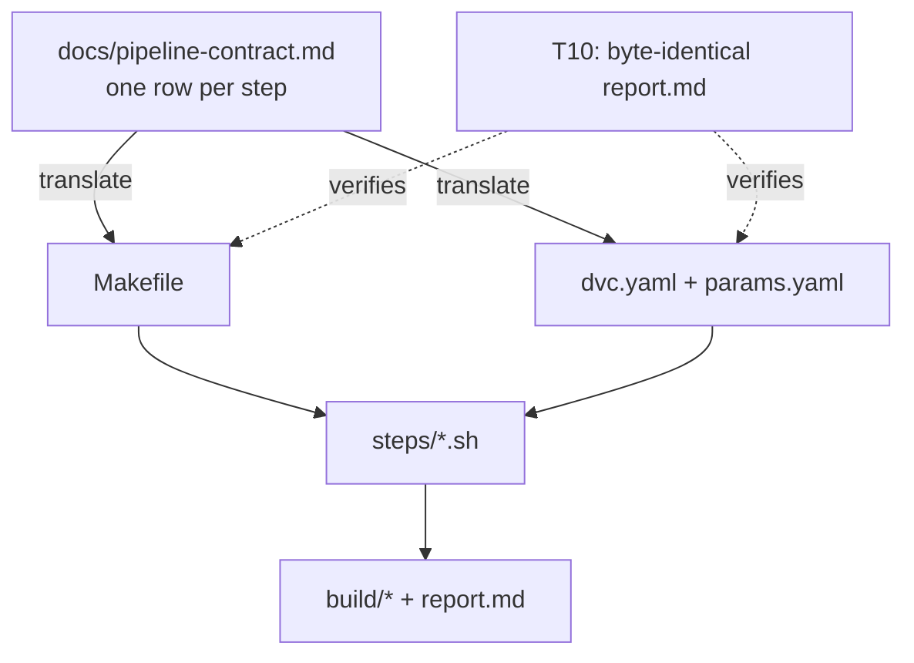

# Pipeline contract

This table is the single source of truth for the pipeline. The Makefile and
`dvc.yaml` are translations of it. When a step changes, update this table, the
Makefile, and `dvc.yaml` in the same change.

Run every command from the repository root.

| Step | Command | Inputs (deps) | Output | Params |
|---|---|---|---|---|
| `rows` | `steps/rows.sh data/countries.tsv build/rows.jsonl` | `data/countries.tsv`, `steps/rows.sh` | `build/rows.jsonl` | none |
| `table` | `steps/table.sh build/rows.jsonl build/table.md` | `build/rows.jsonl`, `steps/table.sh`, `lib/suppress_repeat.mlr`, `lib/align.lua` | `build/table.md` | none |
| `letters` | `steps/letters.sh COUNTRY build/rows.jsonl build/letters.md` | `build/rows.jsonl`, `steps/letters.sh`, `lib/letter.mlr` | `build/letters.md` | `country` |
| `report_md` | `steps/report.sh report.md prose/intro.md build/table.md build/letters.md` | the three `.md` inputs, `steps/report.sh` | `report.md` | none |
| `report_docx` | `steps/report.sh report.docx prose/intro.md build/table.md build/letters.md` | the three `.md` inputs, `steps/report.sh` | `report.docx` | none |

## Step conventions

1. Run from the repository root. Arguments are positional: parameters first,
   then inputs, then the output.
2. Start with `set -euo pipefail`.
3. Write output atomically: a temporary file, then `mv` only on success, with a
   trap that removes the temporary file on any exit. A failed step must never
   leave a partial or empty output.
4. Errors go to stderr as `error[code]: message` and exit non-zero. Codes in
   use: `no-rows`.
5. No orchestrator syntax, no `$(MAKE)`, no `dvc`. Each step must run by hand.
6. Each step owns its own gates (empty output, missing fields), so every
   orchestrator gets them for free.

## Orchestrator notes

- **Make** compares timestamps and does not track the `COUNTRY` value or a
  changed command. Use `make clean` or `make -B` after changing a parameter.
- **DVC** tracks content hashes, command text, and `params.yaml`. It removes a
  failing stage's declared outputs before running it, so a failure leaves that
  output absent rather than partial. Downstream outputs stay stale until the
  next successful run.
- `report.docx` is not byte-identical across builds because pandoc embeds
  document metadata. `dvc.lock` may therefore churn on that output. Only
  `report.md` determinism is tested (T9 deliberately does not compare docx
  bytes).
- A literal `${...}` inside `dvc.yaml` must be escaped as `\${...}`. Keeping
  Miller code in the step scripts normally avoids this.
