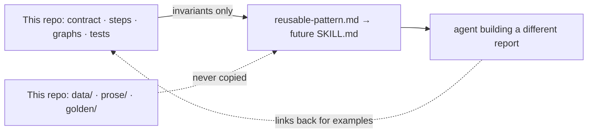

# Reusable pattern: lightweight reproducible reports

This is the candidate content for a skill another coding agent could load. It is
not installed anywhere and it adds no tool to this pipeline. This repo stays the
worked example; the doc carries only what transfers to a different report.



## When this applies

| Situation | Best storage for the pattern |
|---|---|
| Agent works inside this repo | Here: `AGENTS.md`, `docs/pipeline-contract.md`, `reportkit_mvp_spec_v3.md` |
| Agent builds a different report with the same shape | A small skill whose invariants match this doc and which links here |
| Several reports or several agents reuse it | Same skill plus skeleton templates, added only after a second real use |

A worked example teaches *what was built*. A skill teaches *what must remain
true*. Pointing at this repo alone is enough for the first row, not the second.

## What transfers

| Invariant | Why it matters | Proven here by |
|---|---|---|
| Three layers: tools, `steps/*.sh`, graph-only orchestrator | A new orchestrator is a translation, not a rewrite | T10: Make and DVC produce byte-identical `report.md` |
| One contract table is the source of truth | Prevents the graph and the scripts from drifting | `docs/pipeline-contract.md`; T10 |
| Orchestrators contain no logic | Steps run by hand, so any graph can call them | step conventions in `AGENTS.md` |
| Facts come from tools, never from the model | Agents type prose and config, not data values | golden diff in `tests/run.sh` |
| Each step owns its gates and writes atomically | Every orchestrator gets the checks for free | loud-failure and hostile-value tests |
| Python only when a test fails and Miller/Lua cannot do it in a line | Keeps the stack small and deterministic | `docs/gaps.md`, `reportkit_mvp_spec_v3.md` §12 |
| Build, read stderr, fix, rerun; diff against a golden | Closes the loop for an agent with no memory of the build | `tests/run.sh` |

## What does not transfer

- `data/`, `prose/`, `tests/golden/`, and the selected parameter are report
  specific. Do not copy them into a skill.
- `AGENTS.md` is this repo's rulebook. A new repo writes its own; the skill
  point is the pattern, not a second copy of those rules.
- The Phase 2 Python design in the spec is deferred. Do not seed a new report
  with it; wait for a failing test.

## Portable skeleton

No data values belong in these files. Placeholders only.

```text
<report>/
├── docs/pipeline-contract.md   Step | Command | Deps | Out | Params
├── steps/                      small scripts: args, atomic output, gates
├── lib/                        deterministic helpers (Miller, Lua)
├── prose/                      agent-written narrative
├── Makefile                    graph only
├── dvc.yaml, params.yaml       graph only; alternative to Make
├── tests/                      fixtures, golden output, acceptance suite
└── build/                      generated; ignored by git
```

## Decision procedure for an adopting agent

```text
on(request for a reproducible report pipeline)
  if the repo already follows the pattern
    follow its own rules; build; diff golden; never delete a failing gate
  else
    write the contract table FIRST, one row per step
    implement steps in order: facts -> display -> prose -> report
    translate the table into one graph only (Make or DVC)
    put a gate in each step; add a golden output and an equivalence test
    build; read stderr; fix; rerun; diff golden
```

Split work by kind of change: compute, filter, sort, join, or bucket is a data
step; layout is a display step; narrative is prose. A new tool needs a failing
test first.

## Gotchas worth writing down before an agent rediscovers them

- Make compares timestamps and ignores a changed parameter. Force a clean
  rebuild after a parameter change.
- DVC deletes a failing stage's declared outputs and leaves downstream outputs
  stale until the next success. A failure is absent output, not partial output.
- DVC interpolates `${...}`; a literal one in `dvc.yaml` must be escaped. Keep
  that syntax inside step scripts instead.
- `report.docx` is not byte-identical across builds, so only Markdown
  determinism is contracted. Do not "fix" a churning hash.
- A repeat-blanking helper needs its upstream sort; removing the sort is
  silently wrong, and the test for it is deferred.
- Keep the orchestrator equivalence test green. If the graphs disagree, the
  contract table or a step is wrong, not the test.

## Turning this into a skill, if that becomes worthwhile

1. Keep this repo as the reference implementation; do not inline its data into
   the skill.
2. Write one `SKILL.md`: when to use it, the invariants table above, the
   decision procedure, the gotchas, and a link to this doc. Do not restate
   `AGENTS.md`.
3. Add skeleton templates with placeholders only — contract table, one step
   script, one graph, one test harness.
4. Validate by handing a fresh agent a tiny unrelated dataset and only the
   skill. Every question it asks is a missing section.
5. A scaffolding CLI can wait until reuse is real; under this repo's rules a
   new tool needs a failing test that requires it.
