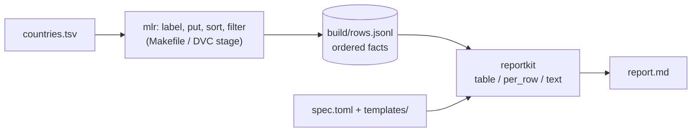

# reportkit: MVP specification for a coding agent

Status: ready to build. Read this whole file first, write the golden tests second, implement third.

## 0. One-paragraph summary

`reportkit` turns **ordered rows of facts** (JSONL) into **deterministic Markdown**: aligned tables and per-row prose from templates. It does **not** fetch, filter, sort, derive, or join data. That work belongs upstream (Miller, SQL, anything that can emit JSONL), wired together with `make` or DVC. The design is distilled from *The AWK Programming Language, 2nd ed.*, chapter 5, where `prep` (data) and `form` (display) are separate programs joined by a pipe. `reportkit` is `form`.



## 1. Goals and non-goals

**Goals**

1. Serve humans (Python library, Neovim via shell filter) and coding agents (CLI with stdin/stdout, JSON errors) through one core.
2. Minimize generated tokens: an agent writes a small spec and optional templates. **It never types a fact.**
3. Byte-identical output for identical inputs (clean git diffs, safe in-place regeneration).
4. Fail loudly with errors that name the problem and suggest the fix.
5. Python 3.14, standard library only. No `eval`, no network, no database code.

**Non-goals for MVP**

Sorting, deriving columns, filtering, joins, source adapters (SQL, Databricks, SQLite), region markers for in-place refresh, images/figures, docx/pptx/pandoc hooks, streaming, plugin discovery, template conditionals or loops.

**The boundary rule.** If a change alters *what a fact is* (compute, filter, sort, join, bucket), it belongs upstream. If it alters *how a fact is displayed* (alignment, labels, number format, suppressing repeated labels, wording around a value), it belongs here.

## 2. Core entities

```python
@dataclass(frozen=True)
class Rows:                        # facts, exactly as received
    columns: tuple[str, ...]       # taken from the first row; every row must have the same keys
    data: tuple[dict, ...]         # ORDER IS MEANINGFUL. Never reorder.

@dataclass(frozen=True)
class BlockSpec:                   # one [[block]] from spec.toml
    type: str                      # "table" | "per_row" | "text"
    opts: dict

@dataclass(frozen=True)
class Spec:
    path: Path                     # relative paths in the spec resolve against its directory
    blocks: tuple[BlockSpec, ...]

@dataclass(frozen=True)
class Error:
    code: str                      # stable machine-readable code (section 8)
    message: str
    hint: str | None = None
    where: str | None = None       # e.g. "spec.toml block 1", "templates/letter.md.tmpl:3"
```

Types come from JSON (`int`, `float`, `str`, `bool`, `None`). There is no schema declaration, because the upstream tool already typed the data.

## 3. Interfaces

### 3.1 CLI

```text
reportkit cols  [PATH|-]          # print column names from the first row as a JSON array
reportkit check SPEC              # validate everything without rendering; exit 0 or 1
reportkit build SPEC              # Markdown to stdout; runs check first
reportkit build SPEC --rows -     # use stdin as rows for every block that omits `rows` (see 4.1)
```

- Errors go to **stderr**, one per line, as JSON objects (`{"code":..., "message":..., "hint":..., "where":...}`) when `--errors=json`, otherwise as readable text.
- Exit codes: `0` success, `1` validation or data errors, `2` usage or I/O errors.
- Only stdout carries the report. Nothing else may be printed there.
- Neovim needs nothing special: `:%!reportkit build spec.toml` or `vim.system({...}, {stdin = ...})`. `cols` feeds column-name completion.

### 3.2 Python API

```python
from reportkit import read_jsonl, load_spec, check, build, table, compile_template

rows: Rows = read_jsonl("build/rows.jsonl")          # path or file object
spec: Spec = load_spec("spec.toml")
errors: list[Error] = check(spec)
md: str = build(spec)

md_table: str = table(rows, cols=[...], headers={...}, fmt={...}, suppress_repeat="continent")
tpl = compile_template("In {continent}, {country} ...")   # file-template dialect
section: str = per_row(rows, lambda r: t"## {r['country']}\n{r['pop']:,} million people")  # t-string dialect
section2: str = per_row(rows, tpl.bind)                    # same renderer for both dialects
```

Library functions that can fail raise `ReportError(errors: list[Error])`.

## 4. Spec format (`spec.toml`)

Display only. No `derive`, `sort`, or `where` keys exist. Unknown keys are errors with a nearest-match hint.

```toml
[[block]]
type    = "table"
rows    = "build/rows.jsonl"
cols    = ["continent", "country", "pop", "area", "den"]
headers = { pop = "Pop (M)", area = "Area (k km²)", den = "Density" }
fmt     = { den = ".1f" }
suppress_repeat = "continent"

[[block]]
type     = "per_row"
rows     = "build/brazil.jsonl"
template = "templates/letter.md.tmpl"

[[block]]
type = "text"
body = "Source: countries.tsv, area in thousand km², population in millions."
```

> **Mechanical callout — reuse one TOML → model walker.** Both the top-level
> `Spec`/`BlockSpec` models (§2) and any later TOML consumer in this project
> should be built from one shared, iterative decoder: `tomllib` output is a
> plain tree of dicts, lists and scalars; the walker turns tables into frozen
> model instances, arrays into lists, dicts into mappings, a table carrying a
> string `type` tag into a concrete class chosen from a small enum + registry,
> and leaves through unchanged. Unknown keys are rejected at the table where
> they occur. Keep the walker and its two helpers (tag enum, registry spec) in
> one module so the two consumers cannot drift. See §17 for a reference excerpt
> and the design constraints.

### 4.1 Common rules

- `rows`: path (relative to the spec's directory) or `"-"` for stdin. At most one block may use stdin; if the CLI flag `--rows -` is given, blocks without a `rows` key use it. `text` blocks take no rows.
- All blocks are rendered in order and joined by **exactly one blank line**. The final output ends with exactly one `\n`.
- Empty row sets are an error (`no-rows`) unless the block sets `allow_empty = true`.

### 4.2 `table` block

| Option | Required | Meaning |
|---|---|---|
| `cols` | yes | ordered column names; each must exist in the rows |
| `headers` | no | `{col: label}`; default label is the column name |
| `fmt` | no | `{col: python format spec}` applied with `format(value, spec)`; default is `str(value)` |
| `suppress_repeat` | no | one column in `cols`; blank every cell that repeats the previous row's value |
| `allow_empty` | no | default `false` |

Behavior:

- Alignment: a column is **right-aligned** if every non-null value is `int` or `float` (not `bool`), else **left-aligned**. Separator row uses `:---` (left) and `---:` (right).
- Width: per column, the max `len()` of header and rendered cells, minimum 3. Pad with spaces. (East Asian wide characters are a known limitation, see section 10.)
- Cells and headers are escaped with `md_cell`. Padding is applied after escaping, so measured width includes escape characters.
- `suppress_repeat` **requires grouped input**. `check` verifies each distinct value appears in one contiguous run. If not, error `unsorted-group` (see section 8). The tool never sorts.
- `None` in a displayed column is an error (`none-value`).
- Empty string `""` in a displayed column is allowed but produces a `check` **warning** (`empty-value`), since Miller emits `""` for empty cells.

### 4.3 `per_row` block

Renders a file template once per row and joins the results with one blank line. Template grammar is in section 6.

| Option | Required | Meaning |
|---|---|---|
| `template` | yes | path to a template file |
| `allow_empty` | no | default `false` |

### 4.4 `text` block

Renders `body` verbatim as trusted literal text (stripped of one trailing newline). It exists mainly to prove the block seam (section 7): adding it must require **no change** to `cli.py`, `spec.py`, or `render.py`.

## 5. Rendering core (`render.py`)

Reference implementation to adapt. It is an iterative walk of a PEP 750 `Template` (no Python recursion), with context-dependent escaping and a strict `None` policy.

```python
from collections.abc import Callable, Iterator
from dataclasses import dataclass
from string.templatelib import Interpolation, Template

Escaper = Callable[[str], str]

@dataclass(frozen=True)
class Raw:                      # trusted, pre-rendered Markdown; use sparingly
    text: str

def convert(value: object, conversion: str | None) -> object:
    if conversion == "a": return ascii(value)
    if conversion == "r": return repr(value)
    if conversion == "s": return str(value)
    return value

def md_text(s: str) -> str:     # prose context
    for ch in ("\\", "*", "_", "`", "[", "]", "<", ">"):
        s = s.replace(ch, "\\" + ch)
    return s

def md_cell(s: str) -> str:     # table-cell context
    return md_text(s).replace("|", "\\|").replace("\r", " ").replace("\n", " ")

def render_iter(template: Template, *, escape: Escaper = md_text,
                strict: bool = True,
                trace: Callable[[Interpolation], None] | None = None) -> Iterator[str]:
    stack = [iter(template)]
    while stack:
        item = next(stack[-1], None)
        if item is None:
            stack.pop(); continue
        if isinstance(item, str):
            yield item; continue                    # literal parts are trusted structure
        v = item.value
        if trace: trace(item)
        if isinstance(v, Template):
            if item.format_spec or item.conversion:
                raise ValueError(f"{item.expression}: spec/conversion on nested Template")
            stack.append(iter(v)); continue
        if isinstance(v, Raw):
            yield v.text; continue
        if v is None and strict:
            raise ValueError(f"{item.expression} is None")
        yield escape(format(convert(v, item.conversion), item.format_spec))

def render(t: Template, **kw) -> str:
    return "".join(render_iter(t, **kw))
```

Security model: **literal parts and nested Templates are trusted structure; interpolated values are data** and are always escaped. Wrap `format()` failures so the error carries the expression and spec. Verify annotations with the type checker (`Interpolation` may not be generic).

Tables: render each cell with `render_iter(Template(Interpolation(value, col, None, spec)), escape=md_cell)`, measure, pad, then emit the finished table as a **literal** string part of the block's `Template` (already escaped).

## 6. File-template dialect (`templates/*.md.tmpl`)

A mail merge, not Jinja. It mirrors the book's `form.gen`, with names instead of `#1..#4`.

```text
## {country}
In {continent}, {country} has {pop:,} million people on {area:,} thousand km²,
a density of {den:.1f} people per km².
```

Grammar, exhaustively: literal text, `{name}`, `{name:spec}`, `{{` and `}}` for literal braces. `name` must match `^[A-Za-z_][A-Za-z0-9_]*$`.

Implementation notes:

- Parse with `string.Formatter().parse()` **line by line** so errors carry `file:line`. The stdlib parser raises bare `ValueError` with no position.
- Reject: conversions (`!r`), attribute/index access (`{a.b}`, `{a[0]}`), expressions (`{pop/area}`), nested specs (`{x:{w}}`).
- Compile once per block into parts; bind per row as `Template(*parts)` with `Interpolation(row[name], name, None, spec)`. One render path serves both dialects.
- **Never** call `.format()` or build an f-string from template text or row values. Row text containing `{pop}` must render literally.
- Normalize: strip one trailing `\n` from the file.

**Out of scope, with the answer to give instead**

| Wanted | Answer |
|---|---|
| conditionals, loops | derive a column upstream and use `{col}`; or add a block |
| expressions | `mlr put` |
| attribute access | flatten upstream (`mlr flatten`) |
| includes, partials | a block (`text`, later `figure`) |
| filters, helpers | upstream or a block |

If a template wants logic, the fix is a new column or a new block, never a new template feature.

## 7. Block seam (the only extensibility in MVP)

The core must not contain `if block.type == "table"`. Each block owns its options and its preconditions.

```python
class Block(Protocol):
    type: ClassVar[str]
    def check(self, rows: Rows | None, opts: dict) -> list[Error]: ...   # option validation + data preconditions
    def render(self, rows: Rows | None, opts: dict) -> Template: ...

REGISTRY: dict[str, Block] = {}

def block(cls):
    REGISTRY[cls.type] = cls()
    return cls
```

Core loop: look up block type (unknown type is an error with nearest match), load rows, collect `check()` errors, render, join. `check` and `build` both run the same two methods.

Deliberately **not** in MVP: entry points, external module loading, versioning, hooks/events/middleware, cell-formatter registries, base-class inheritance. Promotion path if needed later: tier 1 is `[blocks] modules = [...]` loaded with `importlib` (only when blocks must live outside this repo); tier 2 is discovery and a versioned API (only when a second team publishes blocks).

## 8. Error catalog

| Code | When | Hint should say |
|---|---|---|
| `unknown-block` | `type` not in registry | nearest block type |
| `unknown-option` | key not valid for the block | nearest valid option |
| `missing-option` | required option absent | which one |
| `unknown-column` | column in `cols`/`headers`/`fmt`/`suppress_repeat`/template not in rows | nearest column, plus available columns |
| `bad-row` | a row's keys differ from the first row's | row index |
| `unsorted-group` | `suppress_repeat` value reappears after another value | `add \`sort -f <col>\` upstream`; show the two row numbers |
| `no-rows` | zero rows and not `allow_empty` | check the upstream filter |
| `bad-field` | template field is not a plain identifier | double the braces to write literals, e.g. `{{#id}}` |
| `bad-template` | unbalanced braces, conversion, nested spec | line number |
| `bad-spec` | `format(value, spec)` fails for any row | the row index, value, and spec |
| `none-value` | `None` in a rendered field | the expression and row index |
| `stdin-twice` | more than one block reads stdin | which blocks |
| `empty-value` (warning) | `""` in a displayed field | upstream fill/`nonempty` |

Error messages are product surface for agents: each must be actionable without reading the source.

Example:

```text
error[unsorted-group]: block 1 suppress_repeat="continent"
  "Asia" reappears at row 9 after "Europe" (row 7)
  hint: add `sort -f continent` upstream
```

## 9. Sample data and golden outputs

### 9.1 Upstream (Makefile)

Verify Miller flags against the installed version. Use `$$` for `$` inside Makefiles. Recipe lines start with a tab.

```make
build/rows.jsonl: countries.tsv
	mlr --itsv --implicit-csv-header --ojsonl \
	  label country,area,pop,continent \
	  then put '$$den = 1000 * $$pop / $$area' \
	  then sort -f continent -nr den $< > $@

build/brazil.jsonl: build/rows.jsonl
	mlr --ijsonl --ojsonl filter '$$country == "Brazil"' $< > $@

report.md: spec.toml build/rows.jsonl build/brazil.jsonl templates/letter.md.tmpl
	reportkit build spec.toml > $@
```

The book's `info India` query becomes the `build/brazil.jsonl` target. For DVC, each target becomes a stage.

### 9.2 `countries.tsv` (tab-separated, from the book)

Columns: country, area (thousand km²), population (millions), continent. Densities recomputed from the raw columns match the book's final report; the book's printed `prep2` output has OCR damage, so do not copy it.

```text
Russia	16376	145	Europe
China	9388	1411	Asia
USA	9147	331	North America
Brazil	8358	212	South America
India	2973	1380	Asia
Mexico	1943	128	North America
Indonesia	1811	273	Asia
Ethiopia	1100	114	Africa
Nigeria	910	206	Africa
Pakistan	770	220	Asia
Japan	364	126	Asia
Bangladesh	130	164	Asia
```

### 9.3 `tests/fixtures/rows.jsonl` (committed, so tests do not need Miller)

Already sorted by continent ascending, then `den` descending. `den` is truncated to 4 decimals; rendering uses `.1f`.

```json
{"country": "Nigeria", "area": 910, "pop": 206, "continent": "Africa", "den": 226.3736}
{"country": "Ethiopia", "area": 1100, "pop": 114, "continent": "Africa", "den": 103.6364}
{"country": "Bangladesh", "area": 130, "pop": 164, "continent": "Asia", "den": 1261.5385}
{"country": "India", "area": 2973, "pop": 1380, "continent": "Asia", "den": 464.1776}
{"country": "Japan", "area": 364, "pop": 126, "continent": "Asia", "den": 346.1538}
{"country": "Pakistan", "area": 770, "pop": 220, "continent": "Asia", "den": 285.7143}
{"country": "Indonesia", "area": 1811, "pop": 273, "continent": "Asia", "den": 150.7454}
{"country": "China", "area": 9388, "pop": 1411, "continent": "Asia", "den": 150.2983}
{"country": "Russia", "area": 16376, "pop": 145, "continent": "Europe", "den": 8.8544}
{"country": "Mexico", "area": 1943, "pop": 128, "continent": "North America", "den": 65.8775}
{"country": "USA", "area": 9147, "pop": 331, "continent": "North America", "den": 36.1867}
{"country": "Brazil", "area": 8358, "pop": 212, "continent": "South America", "den": 25.3649}
```

`tests/fixtures/brazil.jsonl` is the last line only.

### 9.4 `tests/golden/table.md`

```markdown
| Continent     | Country    | Pop (M) | Area (k km²) | Density |
| :------------ | :--------- | ------: | -----------: | ------: |
| Africa        | Nigeria    |     206 |          910 |   226.4 |
|               | Ethiopia   |     114 |         1100 |   103.6 |
| Asia          | Bangladesh |     164 |          130 |  1261.5 |
|               | India      |    1380 |         2973 |   464.2 |
|               | Japan      |     126 |          364 |   346.2 |
|               | Pakistan   |     220 |          770 |   285.7 |
|               | Indonesia  |     273 |         1811 |   150.7 |
|               | China      |    1411 |         9388 |   150.3 |
| Europe        | Russia     |     145 |        16376 |     8.9 |
| North America | Mexico     |     128 |         1943 |    65.9 |
|               | USA        |     331 |         9147 |    36.2 |
| South America | Brazil     |     212 |         8358 |    25.4 |
```

### 9.5 `templates/letter.md.tmpl` and `tests/golden/letter-brazil.md`

```text
## {country}
In {continent}, {country} has {pop:,} million people on {area:,} thousand km²,
a density of {den:.1f} people per km².
```

```markdown
## Brazil
In South America, Brazil has 212 million people on 8,358 thousand km²,
a density of 25.4 people per km².
```

### 9.6 Hostile fixture `tests/fixtures/hostile.jsonl`

```json
{"country": "A|B", "continent": "*Asia*", "pop": 1, "area": 2, "den": 500.0}
{"country": "<script>", "continent": "[x](http://y)", "pop": 1, "area": 2, "den": 500.0}
{"country": "{pop}", "continent": "back\\slash", "pop": 1, "area": 2, "den": 500.0}
```

Assertions (write as tests rather than a hand-typed golden, then add a reviewed golden):

- Every table row has the same number of **unescaped** pipes as the header.
- `A|B` renders as `A\|B`; `*Asia*` as `\*Asia\*`; `<script>` as `\<script\>`; `[x](http://y)` has escaped brackets.
- `{pop}` appears literally (no re-parsing).

### 9.7 Combined `tests/golden/report.md`

The three-block spec in section 4 over the fixtures: the table golden, one blank line, the Brazil golden, one blank line, the `text` line, one trailing newline.

## 10. Footguns (each needs a test)

1. **Braces collide with pandoc/LaTeX syntax** (`{#id}`): reject as `bad-field`, hint to double the braces.
2. **No position in stdlib parse errors:** parse line by line.
3. **Silent empty sections** from a mistyped upstream filter: `no-rows` error by default.
4. **Format specs vs mixed JSON types** (`:d` fails on `3.0`): validate `format(v, spec)` on **every** row in `check`, and prefer `,` and `.1f`.
5. **`""` vs `None`:** `None` raises, `""` warns.
6. **Escaping is per context**, and a value is never trusted. The hostile fixture enforces this.
7. **Never re-parse row values** (no `.format()` on user text, no attribute traversal).
8. **Two dialects drift** (t-strings allow expressions, files don't): document files as a strict subset.
9. **Newline accounting:** single rule (strip one trailing `\n`, blocks separated by exactly one blank line), enforced by goldens.
10. **Non-determinism:** no sets or unordered iteration in output paths; add a test running `build` twice and comparing bytes.
11. **Display width:** `len()` is wrong for East Asian wide characters and combining marks. Known MVP limitation; document it, do not fix it yet.
12. **`bool` is an `int` subclass in Python:** exclude `bool` from numeric alignment.

## 11. Repository layout

```text
reportkit/
├── pyproject.toml          # python >=3.14, no runtime dependencies; pytest as dev dependency
├── src/reportkit/
│   ├── __init__.py         # public API exports
│   ├── rows.py             # read_jsonl -> Rows, column checks
│   ├── spec.py             # tomllib parse + shared TOML→model walker, validation, nearest-match hints (difflib)
│   ├── render.py           # render_iter, escapers, Raw
│   ├── templates.py        # file-template compiler (Formatter().parse, line-by-line)
│   ├── blocks.py           # Block protocol, REGISTRY, TableBlock, PerRowBlock, TextBlock
│   └── cli.py              # argparse: cols | check | build
├── tests/
│   ├── fixtures/           # rows.jsonl, brazil.jsonl, hostile.jsonl
│   ├── templates/          # ok, bad-braces, bad-spec, unknown-field, bad-template
│   └── golden/             # table.md, letter-brazil.md, report.md
└── examples/countries/     # countries.tsv, Makefile, spec.toml, templates/letter.md.tmpl
```

## 12. Build order (definition of done per step)

1. **Goldens first.** Commit sections 9.2 to 9.7 as fixtures. Tests fail, as they should.
2. **`rows.py` + `cols`:** `read_jsonl`, `bad-row`, `reportkit cols < rows.jsonl`.
3. **`table` block** until `golden/table.md` is byte-identical.
4. **`render.py` + `templates.py` + `per_row`** until `letter-brazil.md` matches and the hostile assertions pass.
5. **Block seam:** add `text` without editing `cli.py`, `spec.py`, or `render.py`. If an edit is needed, fix the leak and note it.
6. **`check` + error catalog** with JSON output. Include the acceptance tests below.
7. **Combined `report.md`** golden, determinism test, and an `examples/countries` Makefile run (if Miller is installed; skip otherwise).

## 13. Acceptance tests

| # | Test | Expect |
|---|---|---|
| A1 | build table over `rows.jsonl` | equals `golden/table.md` |
| A2 | build per_row over `brazil.jsonl` | equals `golden/letter-brazil.md` |
| A3 | build all three blocks | equals `golden/report.md`; ends with one `\n` |
| A4 | build twice | identical bytes |
| A5 | `cols = ["contnent"]` | `unknown-column`, hint `continent`, lists available columns, exit 1 |
| A6 | shuffled rows with `suppress_repeat` | `unsorted-group` naming both row numbers and the upstream sort hint |
| A7 | empty rows file | `no-rows` |
| A8 | template `{#sec .x}` | `bad-field` with the double-brace hint and line number |
| A9 | template `{country:.1f}` | `bad-spec` naming the row and value |
| A10 | template `{contnent}` | `unknown-column` with hint |
| A11 | hostile fixture | all assertions in 9.6 |
| A12 | row with `None` in a displayed column | `none-value` naming expression and row |
| A13 | `text` block added | no edits outside `blocks.py` |
| A14 | stdout cleanliness | with errors, stdout is empty; all diagnostics on stderr |

## 14. Rules for the coding agent working on this repo

- Write or update golden tests **before** implementation; never edit a golden to make a test pass without explaining why the expected output was wrong.
- Standard library only. No `eval`/`exec`. No dependencies beyond `pytest`.
- Do not add data transformation. If you are tempted to add sort, derive, filter, or join, stop: the answer is a Miller recipe in `examples/`, documented in `docs/recipes.md`.
- Do not add template features. If a template needs logic, propose a derived column or a new block instead.
- Do not type numbers, or invent values, in any spec, template, fixture, or doc that did not come from the data. Fixtures derive from `countries.tsv`.
- Keep error messages actionable: code, message, hint, location.
- Keep the core free of block-type knowledge (section 7).

## 15. Expansion plan (after MVP)

Grow by evidence, not speculation. Replicate real reports (your own past proposals first; then postmortems, ADRs, RFCs, comparison one-pagers) and keep a ledger.

For each report, split every element into FACT, DISPLAY, or PROSE:

```text
FACT     -> upstream recipe (mlr/sql), documented, not a feature
logic in wording -> derived column upstream, template stays dumb
DISPLAY  -> candidate block/option, logged in docs/gaps.md
PROSE    -> written by a human or agent in plain Markdown
```

```text
docs/gaps.md
| id | gap                       | class   | seen in             | status   |
| g1 | subtotal row per group    | display | q3-risk, vendor-cmp | 2/3      |
| g3 | "N of M" summary sentence | fact    | q3-risk             | upstream |
```

**Promotion rule:** only a DISPLAY gap seen in three unrelated reports becomes a block or option.

Per report, record a **residual**: the share of elements that could not be reproduced. It should fall as blocks are added.

Also test with a coding agent on each report: did it use `cols`, `check`, `build`, or type the table itself? Which error did it fail to act on? Did it introduce a number from nowhere? Each failure is an error-message or docs fix, not a feature.

Likely order (the ledger decides): `figure` block (asset path, caption, alt text), table options (subtotals/wrap) if seen three times, `group` block (heading per group), pandoc output hooks (front matter, reference docx/pptx), tier-1 block loading.

## 16. Open questions

1. Should `headers` and `fmt` live in the spec or in a sidecar next to the rows? Start in the spec; extract a sidecar only if a second report repeats them.
2. Should `check` treat `empty-value` as warning or error? Start as warning.
3. Do goldens for hostile data get hand-reviewed or generated? Generate from the reference implementation, then review by hand once and freeze.
4. Pandoc integration point (front matter, `--reference-doc`) once docx/pptx becomes a requirement.

## 17. Shared TOML → model walker (reference excerpt)

The decoder is an iterative walker over `tomllib` output. Both `Spec`/`BlockSpec`
and the per-block option models use it, so the dialect is defined once:

```python
from collections.abc import Mapping
from enum import StrEnum
from typing import Any, Self

import attrs


class TomlEnum(StrEnum):
    @classmethod
    def from_str(cls, value: str) -> Self:
        try:
            result = cls[value.replace("-", "_").upper()]
        except KeyError as err:
            choices = ", ".join([f"{key!r}" for key in cls.__members__])
            msg = f"Expected the following: {choices}"
            err.add_note(msg)
            raise
        return result


@attrs.define(frozen=True)
class Polymorphic[E: TomlEnum]:
    base: type
    enum: type[E]
    templates: Mapping[E, type]


def structure[E: TomlEnum](
    data: Any, tp: Any, *, polymorphic: Polymorphic[E] | None = None, path: str = "$"
) -> Any:
    box: dict[str, Any] = {}
    stack = [("value", data, tp, path, lambda v: box.__setitem__("result", v))]
    while stack:
        kind, node_data, node_tp, node_path, dest = stack.pop()
        if polymorphic is not None and node_tp is polymorphic.base:
            if not isinstance(node_data, dict) or "type" not in node_data:
                raise ValueError(f"Missing 'type' at '{node_path}'")
            node_data = dict(node_data)
            template = polymorphic.enum.from_str(node_data.pop("type"))
            node_tp = polymorphic.templates[template]
        # attrs.has(node_tp) → build fields, reject unknown keys;
        # list/dict → push children; otherwise leaf-check and assign.
        ...
    return box["result"]
```

Constraints: §1 goal 5 is stdlib-only, so the full implementation must replace
`attrs` with frozen dataclasses and `get_type_hints`; native exceptions must be
translated to §8 `Error` values; row-dependent checks stay in `Block.check()`;
and the tag registry lives in `blocks.py` to preserve A13.