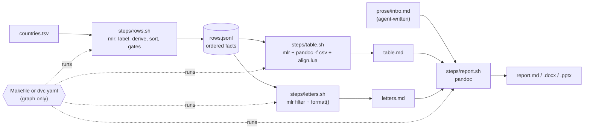

# reportkit v3: step scripts + swappable orchestrator (Make or DVC), Python only where tests demand it

Status: ready to build. Supersedes v1 (all-Python) and v2 (logic inside the Makefile). Read sections 0 to 9 first; write the tests (section 9) before anything else.

## 0. Summary

Agents must not spend tokens typing data into Markdown. Deterministic tools produce every fact and every table; the agent writes only prose and small config.

The design has three layers, and the third is replaceable:

| Layer | What it is | Who owns it |
|---|---|---|
| **Tools** | Miller (`mlr`) for data, pandoc for Markdown/docx/pptx, one Lua filter | off the shelf |
| **Steps** | `steps/*.sh`: small scripts, `inputs -> output`, all real commands live here | this repo |
| **Orchestrator** | declares which step runs when: `Makefile` **or** `dvc.yaml` | thin, swappable |

**Rule: an orchestrator file contains no logic.** It names a step, its inputs, its outputs, and its parameters. Switching from Make to DVC (or Task, just, anything else) is a mechanical translation of the pipeline contract in section 4, and a test (T10) proves both produce byte-identical Markdown.

**Phase 1 has no custom Python.** **Phase 2** is a small Python tool, built only when a Phase 1 test fails and the fix doesn't fit in a Miller or Lua line (section 12). It replaces the body of one step script, so the orchestrators don't change.

Lineage: *The AWK Programming Language*, 2nd ed., chapter 5, where `prep` (data) and `form` (display) are separate programs joined by a pipe.



## 1. Goals and non-goals

**Goals**

1. Humans (Neovim, shell) and coding agents use the same entry point (`make` or `dvc repro`).
2. Facts never pass through the model. Hand or agent edits go to `prose/*.md`, `steps/*.sh`, `lib/*`, and the orchestrator graph.
3. `report.md` is byte-identical across runs and across orchestrators for identical inputs.
4. Failures stop the build loudly, with messages an agent can act on, and never leave a partial output.
5. Word and PowerPoint output come from the same source as Markdown.
6. Moving to a different orchestrator costs an afternoon, not a rewrite.

**Non-goals (Phase 1):** a Python package, a spec format, a template language, plugins, a Neovim plugin, groff/tbl output, figure/schematic blocks, thousands separators.

**Boundary rule.** A change to *what a fact is* (compute, filter, sort, join, bucket) belongs in a Miller step. A change to *how a fact is displayed* belongs in pandoc or the filter. Narrative belongs in `prose/`.

## 2. Repository layout (one report)

```text
reports/q3-proposal/
├── AGENTS.md              # rules for coding agents (section 11)
├── Makefile               # orchestrator A (graph only)
├── dvc.yaml, params.yaml  # orchestrator B (graph only); dvc.lock is generated and committed
├── .gitignore             # build/
├── data/countries.tsv     # raw input; read-only
├── steps/                 # ALL commands live here
│   ├── rows.sh   table.sh   letters.sh   report.sh
├── lib/
│   ├── align.lua              # pandoc filter: right-align numeric columns
│   ├── suppress_repeat.mlr    # blank repeated values in one column
│   └── letter.mlr             # one prose section per row
├── prose/intro.md         # agent-written narrative
├── tests/
│   ├── fixtures/hostile.csv
│   └── golden/report.md
├── build/                 # generated
└── report.md, report.docx # generated
```

`lib/` and `steps/` are shared across reports (symlink or submodule) once there are two reports.

## 3. Tested environment

Miller 6.11.0, pandoc 3.1.3, DVC 3.67.1, GNU Make (Linux), bash. Re-verify flags on your versions (`mlr --version`, `pandoc --version`, `dvc --version`). On macOS, `make` is 3.81: install GNU Make with Homebrew and run `gmake` (the Makefile needs 3.82+ for `.RECIPEPREFIX`).

## 4. Pipeline contract (the single source of truth)

Every orchestrator is a translation of this table. Update the table, the Makefile, and `dvc.yaml` together.

| Step | Command | Inputs (deps) | Output | Params |
|---|---|---|---|---|
| `rows` | `steps/rows.sh data/countries.tsv build/rows.jsonl` | `data/countries.tsv`, `steps/rows.sh` | `build/rows.jsonl` | none |
| `table` | `steps/table.sh build/rows.jsonl build/table.md` | `build/rows.jsonl`, `steps/table.sh`, `lib/suppress_repeat.mlr`, `lib/align.lua` | `build/table.md` | none |
| `letters` | `steps/letters.sh COUNTRY build/rows.jsonl build/letters.md` | `build/rows.jsonl`, `steps/letters.sh`, `lib/letter.mlr` | `build/letters.md` | `country` |
| `report_md` | `steps/report.sh report.md prose/intro.md build/table.md build/letters.md` | the three `.md` inputs, `steps/report.sh` | `report.md` | none |
| `report_docx` | `steps/report.sh report.docx prose/intro.md build/table.md build/letters.md` | same | `report.docx` | none |

### Step script conventions (every `steps/*.sh` follows these)

1. Run from the repo root. Arguments are positional: parameters first, then inputs, then the output.
2. `set -euo pipefail`. A failure anywhere in a pipe fails the step.
3. **Atomic output:** write to a temp file, `mv` into place only on success, remove the temp file on any exit (`trap`). A failed step never leaves a partial or empty output.
4. Errors go to stderr as `error[code]: message` and the exit status is non-zero. Codes in use: `no-rows`.
5. No orchestrator syntax, no `$(MAKE)`, no `dvc`. Steps must run by hand: `steps/rows.sh data/countries.tsv build/rows.jsonl`.
6. A step knows its own gates (empty output, missing fields), so every orchestrator gets them for free.

## 5. Step scripts (as tested)

### 5.1 `steps/rows.sh`

```bash
#!/usr/bin/env bash
# usage: steps/rows.sh IN.tsv OUT.jsonl      (run from the repo root)
set -euo pipefail
in=$1; out=$2; tmp="$out.tmp"
mkdir -p "$(dirname "$out")"; trap 'rm -f "$tmp"' EXIT
mlr --itsv --implicit-csv-header --ojsonl label country,area,pop,continent \
  then put '$den = 1000 * $pop / $area' \
  then sort -f continent -nr den "$in" > "$tmp"
[ -s "$tmp" ] || { echo "error[no-rows]: $out would be empty; check the input" >&2; exit 1; }
mlr --ijsonl --ojsonl put -q 'asserting_present($continent); asserting_present($country); asserting_present($pop); asserting_present($area); asserting_present($den)' "$tmp"
mv "$tmp" "$out"; trap - EXIT
```

### 5.2 `steps/table.sh`

```bash
#!/usr/bin/env bash
# usage: steps/table.sh ROWS.jsonl OUT.md
set -euo pipefail
in=$1; out=$2; tmp="$out.tmp"
mkdir -p "$(dirname "$out")"; trap 'rm -f "$tmp"' EXIT
mlr --ijsonl --ocsv put -s col=continent -f lib/suppress_repeat.mlr \
  then put '$Density = fmtnum($den, "%.1f")' \
  then cut -o -f continent,country,pop,area,Density \
  then rename 'continent,Continent,country,Country,pop,Pop (M),area,Area (k km²)' "$in" \
  | pandoc -f csv -t gfm --lua-filter=lib/align.lua > "$tmp"
[ -s "$tmp" ] || { echo "error[no-rows]: $out would be empty" >&2; exit 1; }
mv "$tmp" "$out"; trap - EXIT
```

### 5.3 `steps/letters.sh`

`filter -s c=... '$country == @c'` compares literally. (The book's `info` used a regex match; use `=~` deliberately if you want that.)

```bash
#!/usr/bin/env bash
# usage: steps/letters.sh COUNTRY ROWS.jsonl OUT.md
set -euo pipefail
country=$1; in=$2; out=$3; tmp="$out.tmp"
mkdir -p "$(dirname "$out")"; trap 'rm -f "$tmp"' EXIT
mlr --ijsonl --ojsonl filter -s c="$country" '$country == @c' then put -q -f lib/letter.mlr "$in" > "$tmp"
[ -s "$tmp" ] || { echo "error[no-rows]: no rows for country '$country' in $in" >&2; exit 1; }
mv "$tmp" "$out"; trap - EXIT
```

### 5.4 `steps/report.sh`

The temp file keeps the real extension, because pandoc chooses the output format from it.

```bash
#!/usr/bin/env bash
# usage: steps/report.sh OUT.{md,docx,pptx} INPUT.md...     (format chosen by extension)
set -euo pipefail
out=$1; shift
d=$(mktemp -d); trap 'rm -rf "$d"' EXIT; tmp="$d/$(basename "$out")"
case $out in
  *.md) pandoc "$@" -t gfm --wrap=none -o "$tmp" ;;
  *)    pandoc "$@" -o "$tmp" ;;
esac
mv "$tmp" "$out"
```

## 6. Support files

### 6.1 `lib/suppress_repeat.mlr`

Input **must already be grouped** by the column; `steps/rows.sh` guarantees this with `sort -f continent`. Removing that sort silently breaks the output (gap G3).

```text
# usage: mlr put -s col=<column> -f lib/suppress_repeat.mlr
begin { @prev = "" }
v = $[@col];
if (v == @prev) { $[@col] = "" } else { @prev = v }
```

### 6.2 `lib/letter.mlr`

A mail merge in the spirit of the book's `form.gen`. Each `{}` takes the next argument.

```text
print format("## {}\nIn {}, {} has {} million people on {} thousand km², a density of {} people per km².\n",
  $country, $continent, $country, $pop, $area, fmtnum($den, "%.1f"));
```

### 6.3 `lib/align.lua`

Right-aligns a column when every non-empty cell is numeric. It runs inside pandoc, so there is no install step. A Python (`panflute`) equivalent produced identical output but ran ~3x slower and adds a dependency (use the string `"AlignRight"`, not `pf.AlignRight`). Prefer Lua until it outgrows ~20 lines.

```lua
function Table(tbl)
  for i, spec in ipairs(tbl.colspecs) do
    local numeric, any = true, false
    for _, b in ipairs(tbl.bodies) do for _, row in ipairs(b.body) do
      local s = pandoc.utils.stringify(row.cells[i].contents)
      if s ~= "" then any = true; if not s:match("^%-?[%d,%.]+$") then numeric = false end end
    end end
    if any and numeric then tbl.colspecs[i] = {pandoc.AlignRight, spec[2]} end
  end
  return tbl
end
```

### 6.4 `prose/intro.md`

```markdown
# Proposal

Narrative written by the agent.
```

## 7. Orchestrators (graph only)

### 7.1 Orchestrator A: `Makefile`

`.RECIPEPREFIX` makes recipe lines start with `>` instead of TAB, which removes a common LLM and editor failure. Steps are listed as dependencies so editing a script rebuilds its output. **Limitation:** Make compares timestamps only. It does not notice a changed `COUNTRY`; run `make clean` (or `make -B`) after changing it. This follows from Make's design and was not separately tested.

```make
.RECIPEPREFIX = >
.DELETE_ON_ERROR:
COUNTRY ?= Brazil

all: report.md report.docx
.PHONY: all clean

build/rows.jsonl: data/countries.tsv steps/rows.sh
> steps/rows.sh $< $@

build/table.md: build/rows.jsonl steps/table.sh lib/suppress_repeat.mlr lib/align.lua
> steps/table.sh $< $@

build/letters.md: build/rows.jsonl steps/letters.sh lib/letter.mlr
> steps/letters.sh "$(COUNTRY)" $< $@

report.md: prose/intro.md build/table.md build/letters.md steps/report.sh
> steps/report.sh $@ prose/intro.md build/table.md build/letters.md

report.docx: prose/intro.md build/table.md build/letters.md steps/report.sh
> steps/report.sh $@ prose/intro.md build/table.md build/letters.md

clean:
> rm -rf build report.md report.docx
```

### 7.2 Orchestrator B: `dvc.yaml` + `params.yaml` (tested)

Setup (once): `git init && dvc init`, commit `.dvc/`, `dvc.yaml`, `dvc.lock`, `params.yaml`; add `build/` to `.gitignore`. `cache: false` keeps text outputs out of the DVC cache so git tracks them directly.

```yaml
# params.yaml
country: Brazil
```

```yaml
# dvc.yaml: thin orchestration only; every command lives in steps/*.sh.
# Keep this graph identical to the pipeline contract (section 4) and the Makefile.
stages:
  rows:
    cmd: steps/rows.sh data/countries.tsv build/rows.jsonl
    deps: [data/countries.tsv, steps/rows.sh]
    outs: [{build/rows.jsonl: {cache: false}}]
  table:
    cmd: steps/table.sh build/rows.jsonl build/table.md
    deps: [build/rows.jsonl, steps/table.sh, lib/suppress_repeat.mlr, lib/align.lua]
    outs: [{build/table.md: {cache: false}}]
  letters:
    cmd: steps/letters.sh ${country} build/rows.jsonl build/letters.md
    deps: [build/rows.jsonl, steps/letters.sh, lib/letter.mlr]
    params: [country]
    outs: [{build/letters.md: {cache: false}}]
  report_md:
    cmd: steps/report.sh report.md prose/intro.md build/table.md build/letters.md
    deps: [prose/intro.md, build/table.md, build/letters.md, steps/report.sh]
    outs: [{report.md: {cache: false}}]
  report_docx:
    cmd: steps/report.sh report.docx prose/intro.md build/table.md build/letters.md
    deps: [prose/intro.md, build/table.md, build/letters.md, steps/report.sh]
    outs: [{report.docx: {cache: false}}]
```

Commands: `dvc repro` (run what changed), `dvc repro -f` (force), `dvc dag --md` (graph as Mermaid), `dvc params diff`.

Verified behavior with this file:

| Change | Stages that ran |
|---|---|
| nothing | none ("up to date") |
| `country: Brazil` → `India` in `params.yaml` | `letters`, `report_md`, `report_docx` only |
| edit a dependency whose output does not change | that stage runs; downstream stages are skipped (content hashes, not timestamps) |
| edit a `cmd` in `dvc.yaml` | that stage and any stage whose input changed |
| `country: Atlantis` (zero rows) | `letters` fails with `error[no-rows]`; no partial `letters.md` is left |
| misspelled field in the `asserting_present` gate | `rows` fails with `is_present type-assertion failed`; exit non-zero |

**`${...}` collision:** DVC interpolates `${name}` in `dvc.yaml`. Miller also allows `${field}`, but with steps holding all Miller code in scripts, `dvc.yaml` normally has no Miller. If a `cmd` must contain a literal `${...}`, write `\${...}`. Verified: an unescaped `${field}` is a parse error (`Could not find 'field'`); the escaped form is passed through to the shell.

**Behavior to know:** DVC deletes a stage's declared outputs before running it, so a failed stage leaves its own output absent (not partial), while downstream outputs stay stale until the next successful `dvc repro`.

### 7.3 Translating to another orchestrator

Mechanical rules, from the contract table:

1. One target/stage/task per row, with the same command string.
2. Dependencies include the step script and every `lib/` file it reads, so edits trigger rebuilds.
3. Parameters become the orchestrator's native parameter mechanism (DVC `params`, Task vars, Make variables), passed positionally to the step.
4. Do not add logic or flags. If a step needs a new behavior, change the script and the contract table.

| Orchestrator | Change detection | Notes |
|---|---|---|
| Make | timestamps | no command/param tracking; `.RECIPEPREFIX` and GNU Make 3.82+ |
| DVC | content hashes, command text, params | verified above; needs git; `dvc.lock` churn |
| Task (go-task) | checksums of `sources` | YAML, single binary; untested here: check whether command edits trigger reruns |
| just | none (command runner) | fine for the entry points, not for the graph |
| Snakemake | file DAG with wildcards | shell strings use `{}` for interpolation, which collides with Miller `format("{}")`; double braces if used |
| doit | file hashes, Python tasks | tasks are code; more flexible, more to review |

Only Make and DVC were run. The other rows come from general knowledge, so verify before adopting one.

### 7.4 Choosing

- **Start with Make.** One report, local data, no parameters worth tracking: it is enough.
- **Move to DVC** when any of these appears: a second report sharing upstream data, parameterized reruns (the book's `info India` pattern), data that lives remotely (Databricks, network database), or a need to reproduce outputs from a given git commit.
- Because steps hold the logic, either choice is reversible.

## 8. Fixtures and golden output

The golden below is the output of both orchestrators (T10) and is unchanged from v2.

### 8.1 `data/countries.tsv` (tab-separated, from the book)

Columns: country, area (thousand km²), population (millions), continent. Densities recomputed from the raw columns match the book's final report; the book's printed `prep2` output has OCR damage, so do not copy it.

```text
Russia	16376	145	Europe
China	9388	1411	Asia
USA	9147	331	North America
Brazil	8358	212	South America
India	2973	1380	Asia
Mexico	1943	128	North America
Indonesia	1811	273	Asia
Ethiopia	1100	114	Africa
Nigeria	910	206	Africa
Pakistan	770	220	Asia
Japan	364	126	Asia
Bangladesh	130	164	Asia
```

### 8.2 `tests/golden/report.md`

```markdown
# Proposal

Narrative written by the agent.

| Continent     | Country    | Pop (M) | Area (k km²) | Density |
|---------------|------------|--------:|-------------:|--------:|
| Africa        | Nigeria    |     206 |          910 |   226.4 |
|               | Ethiopia   |     114 |         1100 |   103.6 |
| Asia          | Bangladesh |     164 |          130 |  1261.5 |
|               | India      |    1380 |         2973 |   464.2 |
|               | Japan      |     126 |          364 |   346.2 |
|               | Pakistan   |     220 |          770 |   285.7 |
|               | Indonesia  |     273 |         1811 |   150.7 |
|               | China      |    1411 |         9388 |   150.3 |
| Europe        | Russia     |     145 |        16376 |     8.9 |
| North America | Mexico     |     128 |         1943 |    65.9 |
|               | USA        |     331 |         9147 |    36.2 |
| South America | Brazil     |     212 |         8358 |    25.4 |

## Brazil

In South America, Brazil has 212 million people on 8358 thousand km², a density of 25.4 people per km².
```

`8358` has no thousands separator (gap G2).

### 8.3 `tests/fixtures/hostile.csv`

```text
country,continent,pop
A|B,*Asia*,1
<script>,[x](http://y),2
{pop},back\slash,3
```

Verified output of `pandoc -f csv -t gfm tests/fixtures/hostile.csv`:

```markdown
| country    | continent       | pop |
|------------|-----------------|-----|
| A\|B       | \*Asia\*        | 1   |
| \<script\> | \[x\](http://y) | 2   |
| {pop}      | back\slash      | 3   |
```

Pipes, asterisks, angle brackets and brackets are escaped; `{pop}` stays literal. **The pandoc CSV reader is the Markdown escaping layer**: nothing concatenates raw values into Markdown by hand.

## 9. Acceptance tests

Write these as an orchestrator-agnostic shell script (`tests/run.sh`) that calls steps and compares files, plus T10 which exercises both orchestrators.

| # | Test | Expect | Status |
|---|---|---|---|
| T1 | clean build (`make clean && make`, or `dvc repro -f`) | exit 0; `report.md` equals `tests/golden/report.md` | verified (both) |
| T2 | build twice from clean, `cmp` the two `report.md` files | byte-identical | verified |
| T3 | `report.docx` exists; table cells right-aligned | `unzip -p report.docx word/document.xml \| grep -c '<w:jc w:val="right" />'` > 0 | verified (39 hits) |
| T4 | misspell a field in the `asserting_present` gate | non-zero exit; stderr contains `is_present type-assertion failed` | verified |
| T5 | param with zero matches (`country: Atlantis`) | non-zero exit; `error[no-rows]`; no partial `build/letters.md` | verified |
| T6 | hostile fixture through `pandoc -f csv -t gfm` | output equals section 8.3 | verified |
| T7 | remove `sort -f continent` from `steps/rows.sh` | **expected to fail silently today**: blank labels in the wrong rows | not tested; see G3 |
| T8 | build `report.pptx` (add a step row) | builds; tables fit on slides | pptx builds only; layout not checked |
| T9 | determinism is checked on `.md` only | do not byte-compare `.docx` | docx byte-identity not tested |
| T10 | **orchestrator equivalence:** `make clean && make`, save `report.md`; then `dvc repro -f`; `cmp` the two | byte-identical | verified |
| T11 | change `params.yaml` only, `dvc repro` | only `letters` and `report_*` stages run | verified |

## 10. Verified findings, footguns, and known gaps

| ID | Finding | Evidence | Mitigation |
|---|---|---|---|
| F1 | A misspelled Miller field is **silent** | `put '$x = $contnent'` exited 0 and produced nothing | `asserting_present` gate in `steps/rows.sh` |
| F2 | A failed recipe can leave an empty target that later runs treat as current | an empty `brazil.jsonl` made `make` "succeed" with an empty section | atomic temp+`mv` in every step, plus `.DELETE_ON_ERROR` |
| F3 | pandoc re-wraps prose | paragraph folded onto two lines | `--wrap=none` in `steps/report.sh` |
| F4 | `fmtnum` has no thousands separator | `fmtnum(8358, "%'d")` printed `%!'(int64=8358)d` | gap G2 |
| F5 | Miller `--omd` escapes `\|` but not `*` | `*x*` passed through | use pandoc's CSV reader for Markdown |
| F6 | panflute API differs from its docs | `pf.AlignRight` raised AttributeError | use string `"AlignRight"` |
| F7 | TAB-indented recipes are fragile for LLMs | recurring tab/space failures | `.RECIPEPREFIX = >`; GNU Make 3.82+ (macOS: `gmake`) |
| F8 | docx alignment grep misses | pandoc writes a space before `/>` | grep for `<w:jc w:val="right" />` |
| F9 | DVC interpolates `${...}` | unescaped `${field}` in a `cmd` is a parse error | write `\${...}` or keep Miller in scripts |
| F10 | Make ignores parameter and command changes | by design (timestamps only); not separately tested | `make clean`, or use DVC |
| F11 | DVC removes a failing stage's outputs; downstream outputs stay stale | observed with the Atlantis and typo tests | acceptable; rerun after fixing |

### Known gaps (the Phase 2 backlog)

| ID | Gap | Why it matters |
|---|---|---|
| G1 | Errors are tool-native (Miller/pandoc stderr), no "did you mean" hint | agents recover less cheaply |
| G2 | No `{x:,}` thousands formatting | `8,358` vs `8358` |
| G3 | `suppress_repeat` has no grouped-input check | removing the upstream sort gives silently wrong output |
| G4 | No JSON error output | editor/agent integration |
| G5 | Template is Miller `format()`: positional `{}`, no per-field specs | repeated arguments, harder to read |
| G6 | One table style per pandoc run; no subtotals | likely first "real report" need |

## 11. `AGENTS.md` (rules for the coding agent)

```text
- Never type data values into Markdown, prose, or config. Data comes from build/ only.
- Edit: prose/*.md, steps/*.sh, lib/*, and the orchestrator graph (Makefile, dvc.yaml, params.yaml).
  Do not edit anything under build/ or report.*.
- Logic lives in steps/*.sh. The Makefile and dvc.yaml contain no logic: only step name, deps, outputs, params.
- When you add or change a step, update the pipeline contract table, the Makefile, AND dvc.yaml in the same change.
  Test T10 (orchestrator equivalence) must stay green.
- New or changed numbers come from a Miller step, never from your own arithmetic.
- Every column used in a display step must be listed in the asserting_present gate in steps/rows.sh.
- Steps follow the conventions in section 4: positional args, set -euo pipefail, atomic output, error[code] on stderr.
- Loop: run the build, read stderr, fix, rerun. Do not "fix" a failing gate by deleting it.
- After the build, diff report.md against tests/golden/report.md. If you change a golden, say why the old one was wrong.
- Do not add Python, extra filters, or new tools without a failing test that requires it (section 12).
- To find a field name: mlr --ijsonl --ojson head -n 1 build/rows.jsonl
- In dvc.yaml, escape a literal ${...} as \${...}.
```

## 12. Phase 2: the Python tool (only if tests demand it)

### 12.1 Trigger rule

Build Phase 2 only when one of G1 to G6 blocks real work **and** the fix is more than a line or two of Miller or Lua. Keep a ledger:

```text
docs/gaps.md
| id | gap                         | class   | seen in             | status     |
| G3 | no grouped-input check      | display | q3-risk, vendor-cmp | 2/3        |
| G2 | thousands separator         | display | q3-risk             | workaround |
```

Classify each gap as FACT (fix upstream in Miller; document as a recipe), PROSE (the agent writes it), or DISPLAY (candidate feature). **Promote a DISPLAY gap only after it appears in three unrelated reports.** Replicate your own past proposals first; they are the most representative corpus.

### 12.2 Scope: replace one step's body, not the architecture

Inputs and outputs do not change: `rows.jsonl` in, a Markdown fragment out, same golden files, same orchestrators. For example, `steps/table.sh` becomes:

```bash
#!/usr/bin/env bash
# usage: steps/table.sh ROWS.jsonl OUT.md
set -euo pipefail
in=$1; out=$2; tmp="$out.tmp"; trap 'rm -f "$tmp"' EXIT
reportkit table --spec spec/table.toml < "$in" > "$tmp"
mv "$tmp" "$out"; trap - EXIT
```

Add `spec/table.toml` to that step's `deps` in both orchestrators and the contract table.

Python 3.14, standard library only (`tomllib`, `string.templatelib`, `argparse`, `json`). Nothing in the package fetches, sorts, derives, filters, or joins.

```text
reportkit cols  [PATH|-]     # column names from the first row, as a JSON array
reportkit check SPEC         # validate spec against rows; JSON errors; exit 0/1
reportkit table --spec SPEC  # Markdown table on stdout
reportkit rows  --template T # one section per row from a {field}/{field:spec} template
```

Likely promotion order:

1. **Checks (G1, G3, G4):** unknown column with nearest match, `suppress_repeat` on ungrouped input (`unsorted-group`, hint `add sort -f <col> upstream`), zero rows, `None` values, as JSON errors `{code, message, hint, where}` on stderr.
2. **Format specs (G2, G5):** Python format specs (`{pop:,}`, `{den:.1f}`) in file templates.
3. **Table layout (G6):** subtotals, wrap rules, only if seen three times.
4. **Block seam:** a small registry so new block types never touch the core (12.4).

Template grammar for `reportkit rows` is a deliberate mail merge: literal text, `{name}`, `{name:spec}`, `{{`, `}}`. Reject conversions, attribute access, expressions, and nested specs. Parse line by line with `string.Formatter().parse()` so errors carry `file:line`. Never re-parse row values or call `.format()` on them. If a template wants logic, derive a column in Miller instead.

### 12.3 Rendering core (adapt as needed)

Literal parts and nested `Template`s are trusted structure; interpolated values are data and always escaped.

```python
from collections.abc import Callable, Iterator
from string.templatelib import Interpolation, Template

def md_text(s: str) -> str:
    for ch in ("\\", "*", "_", "`", "[", "]", "<", ">"):
        s = s.replace(ch, "\\" + ch)
    return s

def md_cell(s: str) -> str:
    return md_text(s).replace("|", "\\|").replace("\r", " ").replace("\n", " ")

def render_iter(t: Template, *, escape: Callable[[str], str] = md_text,
                strict: bool = True) -> Iterator[str]:
    stack = [iter(t)]
    while stack:
        item = next(stack[-1], None)
        if item is None:
            stack.pop(); continue
        if isinstance(item, str):
            yield item; continue
        v = item.value
        if isinstance(v, Template):
            stack.append(iter(v)); continue
        if v is None and strict:
            raise ValueError(f"{item.expression} is None")
        yield escape(format(v, item.format_spec))
```

### 12.4 Block seam (extensibility without a plugin system)

```python
class Block(Protocol):
    type: ClassVar[str]
    def check(self, rows, opts) -> list[Error]: ...   # option validation + data preconditions
    def render(self, rows, opts) -> Template: ...

REGISTRY: dict[str, Block] = {}
```

The core must never contain `if block.type == ...`. Add a trivial `text` block as the seam test: it must need no edits outside `blocks.py`. External module loading and anything beyond waits for a second repo that needs it.

### 12.5 Error catalog (Phase 2)

| Code | When | Hint |
|---|---|---|
| `unknown-column` | name not in rows | nearest column; list available columns |
| `unsorted-group` | `suppress_repeat` value reappears after another | add `sort -f <col>` upstream; name both row numbers |
| `no-rows` | zero rows and not `allow_empty` | check the upstream filter |
| `bad-field` | template field not a plain identifier | double braces for literals, e.g. `{{#id}}` |
| `bad-template` | unbalanced braces, conversion, nested spec | line number |
| `bad-spec` | `format(value, spec)` fails for any row | row index, value, spec |
| `none-value` | `None` in a rendered field | expression and row index |
| `empty-value` (warning) | `""` in a displayed field | upstream fill |

### 12.6 Complexity budget (slop check)

Expect about 500 lines of source (rows ~40, spec ~90, render ~60, templates ~70, blocks ~150, cli ~80) and roughly the same in tests. Investigate if source passes 800 lines, any module passes 250, a runtime dependency appears, or the template grammar grows. If a feature can be one Miller or Lua line, it does not belong in Python.

## 13. Build order for the agent

1. Create the layout and `data/countries.tsv`. Write `tests/golden/report.md` (8.2) and `tests/fixtures/hostile.csv` (8.3).
2. Write `steps/*.sh` and `lib/*` exactly as in sections 5 and 6; run each step by hand from the repo root.
3. Add the `Makefile`; get T1 green.
4. Add `tests/run.sh` for T2 to T6, and confirm each failure mode really fails by breaking the input on purpose.
5. Add T3 (docx alignment), then a `report.pptx` row and look at the slide by eye once.
6. Add `dvc.yaml` and `params.yaml`; get T1, T10 and T11 green. Commit `dvc.lock`.
7. Replicate one real proposal of your own end to end. Fill `docs/gaps.md`.
8. Only then decide whether Phase 2 is needed. If so, start with `reportkit check` (G1, G3, G4): it adds safety without changing any output.

## 14. Where groff/tbl fit

Not in Phase 1. groff and tbl produce PDF or terminal output but cannot feed Word or PowerPoint, and tbl needs its own escaping layer: a cell line starting with `.`, a backslash, or a cell ending in `T{` breaks or aborts the table (verified), and long cells only produce a width warning. If a PDF or ASCII target is wanted later, add it as another step reading the same `rows.jsonl`, with escaping handled in code. `pic` and `grap` are the likely route for the schematics asset library (a future `figure` step: sources in `assets/`, rendered by the orchestrator).

## 15. Open questions

1. `headers` and number formats live in `steps/table.sh` (`rename`, `fmtnum`). Extract a sidecar or spec file only when a second report repeats them.
2. Whether `docx` needs a `--reference-doc` template for corporate styling (likely yes once stakeholders see the first one).
3. pptx: how much table layout pandoc's slides tolerate; may need a Lua filter or a table-splitting step.
4. Whether DVC remotes (S3, Databricks volumes) are the right home for `rows.jsonl` snapshots once data is large.
5. Whether Make should keep a stamp file for `COUNTRY` so parameter changes rebuild, or whether that is the signal to move to DVC.